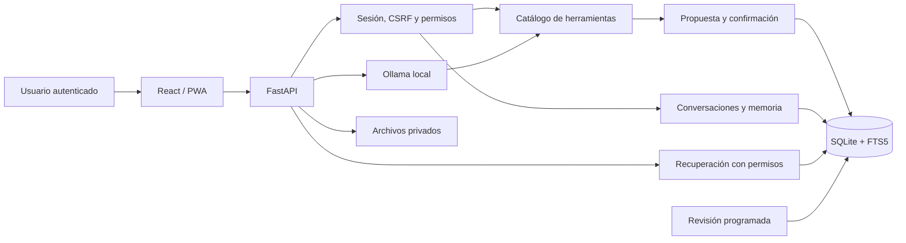
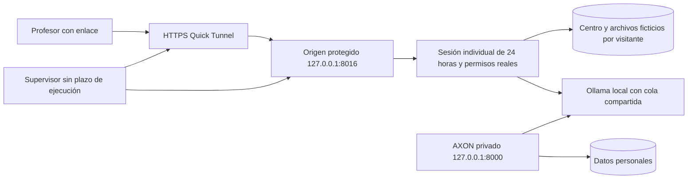
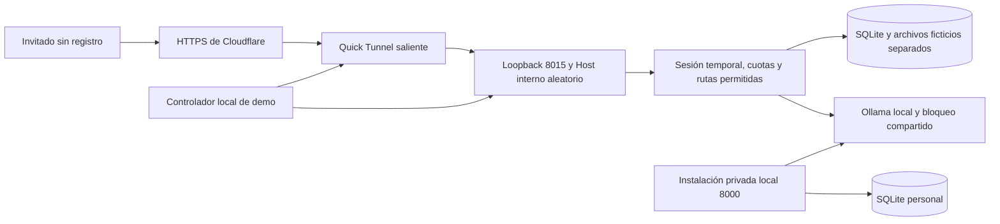

# Arquitectura

## Componentes y ejecución

FastAPI sirve los recursos compilados de React y la API desde el mismo origen. SQLite con WAL guarda las cuentas y los datos. El instalador crea el esquema y el asistente local configura el administrador. Ollama, las operaciones de OCR, voz y matemáticas y las descargas con procedencia actúan como servicios o procesos delimitados. Se pueden ejecutar perfiles de demostración aislados e independientes de la instalación principal.

## Aplicación instalable

El manifiesto identifica AXON, con AXON como nombre corto, iconos regulares y adaptables, origen raíz, modo standalone y tema oscuro. El frontend ofrece el evento de instalación del navegador y pasos manuales si falta. Se cargan los módulos grandes al entrar en su vista. La interfaz móvil usa áreas seguras, foco visible, un menú que puede cerrarse tocando fuera y un compositor que se adapta al espacio visible.

El service worker usa red para las navegaciones y presenta una página informativa si la conexión falla. Su caché contiene únicamente una lista de recursos del cliente, fuentes y archivos de compilación versionados, solicitados sin credenciales. La API queda fuera del worker. La copia autorizada de información pública guarda solo los campos previstos y caduca a los siete días.

## Publicación completa y entorno ficticio

`teacher_prepare.py` crea una plantilla nueva de Nébula, ficticia y sin contraseñas, con documentos originales de demostración. `demo_tenants.py` clona su grafo de claves externas, remapea los identificadores también en JSON y copia los archivos por visitante. `teacher_demo.py` crea sesiones de 24 horas, valida el perfil, limita abuso y borra cada centro temporal completo. Permite cambiar entre Alumno, Profesor y Administrador ficticio dentro del mismo centro aislado, rotando la sesión y su protección CSRF. La administración ficticia tiene acceso a las funciones educativas autorizadas de su centro. Las operaciones del servidor permanecen cerradas. `teacher_models.py` y la migración aditiva 0006 añaden una tabla y un índice de cuotas sin alterar las filas históricas. `nebula_models.py` y la revisión 0008 incorporan tutorías, admisiones, ponderaciones y guías de corrección con permisos docentes.

`teacher_service.py` fija la base separada y el origen loopback 8016. `teacher_launch.py` inicia backend y cloudflared desacoplados de la terminal, valida el ejecutable, espera la propagación DNS y una respuesta HTTPS real antes de ofrecer la URL, y detiene el antiguo túnel solo entonces. Su supervisor revisa procesos cada quince segundos y HTTPS cada minuto; tras tres fallos o muerte de un proceso reconstruye la publicación. No hay fecha límite de ejecución. La parada explícita desactiva la vigilancia antes de cerrar los procesos propios, identificados por PID, hora de creación, carpeta y comando. El ejecutable existente y el panel local usan este controlador; el entorno público se genera mediante una lista de variables permitidas, sin `.env` personal ni secretos heredados.

## Perfil público anterior 0.5 · conservado como histórico

`demo_service.py` fija el directorio y la base ficticia, el puerto y las cookies seguras; no reutiliza la URL de base personal del entorno. `guest.py` valida el perfil, el Host secreto y el origen público exacto, limita rutas, crea identidades de alumno sin contraseña, aplica cuotas atómicas y limpia sesiones. `guest_models.py` y la migración aditiva 0005 incorporan dos tablas, sin modificar las migraciones ni las tablas anteriores. `parse_tool` vuelve a comprobar la lista de invitados incluso si el modelo propone una función prohibida. Las consultas aplican las ACL existentes.

`demo_launch.py` solo admite operaciones fijas: start, stop, status, restart y link. Verifica el digest del conector y reconoce sus procesos por PID, hora de creación, carpeta y comando. Cierra primero la publicación y luego sus procesos; no detiene Ollama ni la instancia personal. Un archivo privado actualiza el nombre HTTPS real después de que cloudflared lo emite. Hasta ese momento, el origen devuelve 503. La interfaz privada proporciona controles y recuentos de invitados; la pública no tiene acceso al controlador.

El chat utiliza HTTP normal, sin SSE, compatible con Quick Tunnels. `ai.py` combina una cola por proceso con un bloqueo de archivo compartido por el proyecto; una sola inferencia entre la instancia pública y la privada. Las respuestas tienen tiempo y tamaño acotados. La cancelación no elimina el mensaje ya aceptado; cerrar la sesión durante la generación evita guardar una respuesta huérfana. El almacenamiento del navegador conserva solo el shell estático y preferencias visuales, no conversaciones.

## Organización del código

- `backend/app/config.py`, `db.py`, `models.py`: configuración, tipos UTC, relaciones y restricciones.
- `auth.py`, `policy.py`: sesiones opacas, contraseñas, autorización independiente de IA.
- `memory.py`, `chat.py`: registros completos, recuperación, idempotencia de envío y resúmenes extractivos.
- `agent.py`, `ai.py`, `tools.py`: interpretación reproducible de intenciones, adaptador Ollama y catálogo cerrado de herramientas.
- `education.py`: consultas académicas, entregas, avisos, salidas e importación de horarios.
- `documents.py`: comprobación, extracción, fragmentación y recuperación documental.
- `reports.py`: informes y mantenimiento, sin entradas privadas de alumnado.
- `admin.py`: cuentas, centro, estructura académica, exportación y eliminación privada.
- `backup.py`, `cli.py`: administración local y recuperación comprobada.
- `frontend/src/`: pantallas, controles reutilizables, cliente de API y tipos.

## Ampliación 0.2

`knowledge_models.py` añade 15 tablas sin modificar las 28 iniciales: enlaces de alta, perfil/materias privadas, fuentes, metadatos docentes, sesiones de horario, unidades, criterios, reglas de evaluación, progreso, sesiones/planes de estudio, tareas personales, conexiones e intentos OAuth. La revisión congelada `0002_learning.py` solo contiene operaciones aditivas. Los nombres reales y los documentos pertenecen a datos privados, no a la semilla de demostración ni al código.

- `academic_import.py` conserva originales, extrae geometría del horario y reglas por tipo de documento, detecta año y registra estado. DOCX incluye inserciones vigentes de control de cambios, excluyendo texto eliminado.
- `knowledge.py`, `learning_tools.py` y `learning_agent.py` relacionan información propia y herramientas autorizadas. Una fuente aportada por alumnado no cambia documentación institucional. Las fechas sin materia elegida permanecen como alternativas.
- `grades.py` usa Decimal y reglas explícitas, sin ejecutar texto documental ni pedir cálculos al modelo. Toda salida se identifica como simulación, con información ausente y fuente histórica cuando corresponda.
- `study.py` mantiene ejercicios/errores propios y progreso sin calificaciones oficiales. El plan se construye con disponibilidad, exámenes, tareas y horario; las confirmaciones revalidan calendario, clases y disponibilidad.
- `notifications.py` genera avisos privados con preferencias, horizonte y deduplicación aunque el centro privado no tenga revisiones institucionales automáticas.
- `classroom.py` implementa OAuth 2/PKCE, tokens Fernet, renovación y API oficial de solo lectura. La simulación no crea tareas académicas reales. Las fechas sin hora quedan pendientes de revisión.
- `research.py` limita lecturas a HTTP/HTTPS público, fija DNS/IP para la conexión, valida redirecciones y limita tamaño/tiempo. No incluye memorias ni documentos en las peticiones externas. El buscador es un adaptador configurable independiente de Ollama.
- `frontend/src/learning.tsx` conecta alta, fuentes, horario privado, progreso, cálculo, estudio, tareas, investigación y Classroom. El service worker v2 no almacena API ni datos privados.

El alta genera solo un hash de token de un uso en la base y un enlace local con permiso 0600; el titular establece la contraseña. Las integraciones usan `data/secrets/integrations.key`, incluida en copias privadas para permitir restauración. Exportación y borrado abarcan las tablas nuevas; los tokens OAuth no se exportan.

## Datos y migraciones

La migración `0001` congela explícitamente 28 tablas, con claves foráneas, restricciones, índices y unicidad. Incluye centros, usuarios, cursos académicos y educativos, grupos, asignaturas, aulas, matrículas, asignaciones, sesiones, intentos de acceso, conversaciones, mensajes, recuerdos, resúmenes, documentos y fragmentos, horarios, eventos, exámenes, tareas, entregas, notificaciones, salidas, propuestas, aprobaciones, auditoría e informes.

Los roles iniciales son valores validados (`student`, `teacher`, `admin`). La política está centralizada; añadir roles requiere ampliar esa política y su restricción de base. No hay editor arbitrario de permisos ni tablas de roles dinámicas en esta versión.

SQLite usa claves foráneas activas, WAL y espera acotada de bloqueos. Los cambios importantes se agrupan en una transacción. FTS5 indexa mensajes, recuerdos y fragmentos mediante disparadores de inserción, actualización y borrado. La búsqueda aplica la autorización en la consulta exterior y no muestra candidatos ajenos ni sus recuentos. Ordena los resultados autorizados por coincidencias textuales. No utiliza embeddings.

SQLAlchemy prepara tipos y claves compatibles con PostgreSQL; se ofrece búsqueda textual mediante `ILIKE` cuando no hay SQLite. La confirmación usa bloqueo por centro en PostgreSQL y bloqueo de escritura en SQLite. Esta compatibilidad no equivale a una validación sobre un servidor PostgreSQL: faltan su controlador, pruebas de concurrencia, despliegue y ajuste de búsquedas.

Para modificar el esquema, añade una nueva revisión Alembic. No alteres una migración ya aplicada. La inicialización comprueba y aplica revisiones, no recrea tablas ni borra registros. `seed_demo` solo actúa en un centro vacío.

## Privacidad y permisos

Cada sesión corresponde a un usuario interno activo. La cookie contiene un token aleatorio; en la base se conserva su hash. Los cambios requieren el token CSRF y origen permitido. Los perfiles no se aceptan desde el cuerpo de la petición para autorizarla.

Las conversaciones, mensajes, recuerdos y documentos personales requieren titularidad. **La administración no obtiene una excepción de acceso a conversaciones privadas.** Alumnado accede a grupos matriculados; profesorado a los asignados y, para escribir sobre una materia, a su asignación concreta. Los documentos públicos o de centro solo son visibles tras validación; los de grupo muestran su estado y procedencia. Un borrador no se considera oficial.

Los identificadores internos son **seudonimización**, no anonimato irreversible. Quien controla los registros de cuenta puede relacionarlos con una identidad. Los datos de demostración son ficticios desde su origen.

## Conversación, memoria e IA

1. La API verifica la titularidad de la conversación.
2. Guarda y confirma el mensaje original antes de llamar al modelo; utiliza `client_id` para evitar duplicados por reintentos.
3. El planificador reconoce intenciones españolas frecuentes sin necesitar el modelo. Una hora o grupo ambiguo provoca una petición de datos, no una publicación inventada.
4. Para ciertas peticiones académicas fuera de los patrones, Ollama puede proponer una llamada estructurada del catálogo. Solo recibe la petición actual y metadatos autorizados; no recibe fragmentos documentales para decidir acciones.
5. Todas las llamadas pasan por esquemas Pydantic, roles, ámbito y reglas de negocio. Una respuesta del modelo no concede autoridad.
6. Para dudas generales se recuperan pocos recuerdos y fragmentos pertinentes, y como máximo diez mensajes recientes, con límites de tamaño y contexto de 4096 tokens configurado en Ollama.
7. Los documentos se tratan como contenido no confiable. La generación de texto no recibe herramientas ejecutables. Los hechos institucionales requieren contexto; el conocimiento general del modelo no se presenta como documentación del centro.
8. Guarda la respuesta y sus herramientas/fuentes. Los resúmenes extractivos se crean desde doce mensajes; nunca reemplazan los originales.

El adaptador carga un único modelo configurado, limita inferencias simultáneas y solicita descarga de memoria de Ollama tras dos minutos de inactividad. No descarga modelos durante el inicio. Si falla, conserva el mensaje original y comunica el modo de demostración. El chat no ofrece streaming de tokens en esta versión; muestra procesamiento real y entrega la respuesta al terminar.

## Herramientas y confirmaciones

El catálogo declara descripción, esquema, perfiles y nivel. No hay herramienta para abrir un terminal ni ejecutar código.

- Nivel 1: consultas de exámenes, calendario, tareas, asignaturas, horarios, documentos y memoria propia.
- Nivel 2: recuerdos solicitados, registro de salida/regreso y elaboración de informes según rol.
- Nivel 3: exámenes, eventos institucionales, cambios/cancelaciones, tareas, horarios, comunicados y validación documental.

Un evento privado solicitado explícitamente puede guardarse según la preferencia personal; si esta está desactivada, requiere propuesta. Las sugerencias institucionales del modelo siempre requieren confirmación.

La propuesta conserva argumentos, autor, estado y caducidad de 24 horas. Confirmar comprueba de nuevo roles, asignaciones, versión y conflictos. Un cambio atómico de estado evita ejecutar dos veces. Evento, examen, avisos, aprobación y auditoría se guardan juntos. Confirmar una propuesta ya aprobada devuelve su resultado previo. Una propuesta rechazada o caducada no se ejecuta.

Los eventos detectan solapamiento de grupo, propietario y aula; los horarios comprueban grupo, profesor y aula, también entre filas de una misma importación. No se dispone de calendario oficial de festivos ni se infieren datos de este.

## Documentos

Los originales se guardan fuera de las rutas públicas con nombre generado, límites de tamaño y descarga adjunta tras autorización. Se verifica el contenedor Office y se rechazan macros, incrustaciones y compresión desproporcionada. PDF se limita a cien páginas; el texto a 500.000 caracteres por documento. La extracción no evalúa fórmulas ni sigue enlaces externos.

Los fragmentos tienen ubicación y orden. Las respuestas documentales estructuradas muestran extractos con título, ubicación, versión, procedencia y estado; así no atribuyen al modelo un contenido inexistente. Los originales extensos pueden superar el límite de extracción: esta versión no garantiza búsqueda completa sobre documentos mayores que ese límite.

## Revisión y conservación

Un proceso del servidor revisa cada cinco minutos si falta el informe de la fecha local de Madrid; genera como máximo uno programado por día y centro. Analiza exclusivamente eventos institucionales, horarios y metadatos documentales. Detecta solapamientos, duplicados, horario incompleto, documentos provisionales y revisiones antiguas. Las correcciones identificables se convierten en propuestas separadas; marcar revisado no significa corregir automáticamente.

También caduca propuestas, sesiones e intentos de acceso; elimina salidas antiguas según la política del centro y prepara recordatorios próximos sin duplicarlos. Los avisos respetan preferencias. Desactivar automatización detiene informes/avisos, manteniendo caducidad de sesiones y conservación limitada de salidas. No hay un planificador externo ni garantías de ejecución mientras AXON está apagado. Usa un solo proceso Uvicorn en esta instalación.

Las conversaciones originales no se purgan automáticamente en demostración. El titular puede exportarlas o borrar datos privados y desactivar su cuenta. La auditoría y las contribuciones institucionales retienen un identificador interno; es un límite declarado del borrado, no una declaración de anonimización.

## PWA, voz y quiosco

El service worker guarda únicamente el shell y recursos estáticos; ignora `/api/` en su caché general. Ni sesiones ni conversaciones se copian a almacenamiento local del navegador. Las preferencias de tema sí se guardan localmente. Sin servidor, la interfaz explica que no puede recuperar datos.

La voz es opcional: en 0.4 usa grabación manual con AudioWorklet, WAV limitado, Vosk español y eSpeak locales. No usa reconocimiento remoto como sustitución. El audio no se conserva y se cancela explícitamente. La consulta pública `/api/public/info` entrega solo datos básicos y documentos públicos validados; alimenta una vista pública en `/kiosk.html`; no hay bloqueo físico del equipo ni despliegue de una estación pública real.

Referencias técnicas consultadas: [FastAPI Security](https://fastapi.tiangolo.com/tutorial/security/), [SQLAlchemy Session Basics](https://docs.sqlalchemy.org/en/20/orm/session_basics.html) y [Ollama Chat API](https://docs.ollama.com/api/chat).

## Ampliación 0.3.1

`agent_models.py` registra once tablas nuevas mediante la migración aditiva 0003. Se conservan congeladas 0001/0002. `orchestrator.py` planifica las intenciones compuestas soportadas, registra cada paso antes de ejecutarlo y usa una sesión/transacción por herramienta. Revalida cuenta, módulo, esquema, rol y ámbito; los fallos posteriores no revierten consultas o escrituras anteriores ya terminadas. El mensaje original usa la idempotencia existente. No se reanuda automáticamente una escritura tras un reinicio.

El plan admite ocho pasos, un presupuesto de 75 segundos comprobado entre pasos, y como máximo dos intentos para consultas de lectura transitorias. Una operación en curso acaba dentro de sus propios límites; cancelar detiene el paso siguiente. No se reintentan escrituras. Las propuestas usan el mecanismo atómico de confirmación existente; el historial verifica sus objetos creados y distingue rechazo, caducidad, resultado incompleto e interrupción. El planificador estructurado combina exámenes, pendientes, horario, temarios y planificación que vuelve a consultar sus dependencias actuales. No se atribuye autonomía general a un modelo: Ollama conserva su propuesta opcional de una herramienta validada fuera de los patrones conocidos.

`semantic.py` usa FastEmbed/ONNX con el modelo multilingüe de 384 dimensiones, archivos locales explícitos y telemetría desactivada antes de cargar el runtime. La descarga pertenece a una orden separada del operador. Los vectores se filtran por usuario, existencia, hash de contenido y fecha antes de ordenar; se combinan con FTS. El texto se limita a 1.600 caracteres por registro y el modelo tiene su propio límite de tokens. Las relaciones son sugerencias, nunca fusiones automáticas. `MemoryAnnotation` conserva el mensaje fuente, estado provisional/confirmado por titular y procedencia. Correcciones invalidan vectores y relaciones; el mantenimiento limpia vectores huérfanos. Los resúmenes cuentan los mensajes y leen solo los últimos dieciséis.

`math_worker.py` construye expresiones SymPy desde un AST permitido. Nunca usa eval, parse_expr ni código generado por un modelo. Es un programa fijo con entrada/salida JSON, límites de CPU, memoria, archivos y tiempo; tras importar las operaciones bloquea apertura de archivos, red y creación de procesos mediante auditoría de Python. No se presenta como contenedor para ejecutar código arbitrario. El padre limita a dos cálculos simultáneos.

`research_sources` compara hasta tres páginas públicas. Conserva DNS fijado, TLS y validación de cada redirección, ahora con resolución acotada y plazo total de lectura. Marca diferencias numéricas en frases equivalentes, sin adjudicar verdad ni detectar toda contradicción conceptual. El lector y el planificador están separados; texto recuperado nunca genera autorizaciones. La consulta externa requiere tema/URL explícitos; no se derivan búsquedas públicas a partir de títulos privados de exámenes.

`extensions.py` declara catálogo, esquemas de argumentos, operaciones de API, permisos, dependencias, configuración, disponibilidad y pruebas. Los interruptores por centro se auditan y se hacen cumplir tanto en herramientas como en API directas. Revocación OAuth y derechos de privacidad siguen disponibles.

`scheduler.py` reclama cada franja de un trabajo con comparación atómica y ejecución única. El siguiente instante se persiste antes de los efectos. Tras un fallo no repite esa franja; tras un reinicio marca reclamaciones antiguas interrumpidas. Respeta titular, rol, centro, pausa, cancelación y módulo. El mantenimiento de cinco minutos ejecuta como máximo veinte trabajos por vuelta. No hay ejecución mientras AXON esté apagado, ni promesa de horario exacto.

`materials.py` crea borradores extractivos con lecturas/actividades y referencias. La revisión usa control de versión. Compartir exige docente autorizado, revisión vigente, confirmación y acceso del grupo a todas las fuentes, incluidos criterios privados vinculados. El documento Markdown publicado se reconstruye desde sus fragmentos revisados y su descarga revalida permisos. No se publica una nota oficial. Las simulaciones solo se guardan por decisión explícita, en `GradeScenario`.

`universal.py` aplica un ámbito SQL independiente para cada familia de resultados. `operations.py` muestra recursos y latencia agregados y trescientos registros efímeros con ruta de plantilla/estado/duración; excluye consultas, cuerpos, nombres e identificadores. Las copias protegidas coordinan archivos y snapshot SQLite, restauran en carpeta temporal nueva y comparan hashes. Conservación de catorce días, límite integrado de 512 MB y sin descarga web de la base privada.

La PWA conserva recursos estáticos y, solo al autorizarla, información del endpoint público obtenido sin cookies, limitada y con caducidad de siete días. Las API privadas siempre evitan cachés. La guía offline y el quiosco público usan contenido textual y no ofrecen cuentas ni micrófono. La internacionalización inicial traduce la navegación española/inglesa, con formularios españoles y contenido original.

Referencias de implementación: [FastEmbed](https://qdrant.github.io/fastembed/examples/Supported_Models/), [privacidad de ONNX Runtime](https://github.com/microsoft/onnxruntime/blob/main/docs/Privacy.md), [advertencia del parser SymPy](https://docs.sympy.org/latest/modules/parsing.html), [entregas de Classroom y permisos](https://developers.google.com/workspace/classroom/reference/rest/v1/courses.courseWork.studentSubmissions/list).

## Ampliación 0.4 — ATLAS

`atlas.py` separa identidad configurada (BASE 100), evidencia institucional (BASE 200) y lectura SQL actual (BASE 300). La identidad se resuelve antes de las herramientas o el modelo. `CoreState` y `CoreRevision` contienen configuración e historia; las reglas de seguridad permanecen en código. Los cambios del núcleo utilizan el catálogo/confirmación existente y control de versión.

`InstitutionalSource` enlaza documentos con URL, consulta, publicación conocida o nula, curso, autoridad, verificación y aplicabilidad. `institutional.py` importa solo un catálogo público contrastado, sin contexto personal. La recuperación filtra ACL y versiones superadas, elimina palabras vacías, prioriza títulos y FTS y aplica umbral. `relevance.py` valida marcadores de cita contra fragmentos suministrados. No es una verificación semántica infalible. La extracción limita texto a 500000 caracteres antes del solapamiento, 100 páginas de subida general o 250 en catálogo institucional.

`ProviderPolicy` guarda selección/límites por centro sin credenciales. Ollama mantiene una inferencia, hasta tres esperas, plazos y salida/contexto acotados. `providers.py` usa destinos oficiales fijos para Gemini/Groq, catálogos actuales y una consulta pública con consentimiento; no recibe el chat privado. Las claves permanecen en configuración del servidor. No hay cambio automático a nube.

OCR, PDF y dictado se ejecutan en trabajadores breves, con límites CPU/memoria/tiempo y seccomp local al proceso. `media_setup.py` prepara modelos explícitamente en el proyecto. El navegador captura solo tras pulsar grabar; el texto resultante requiere revisión antes de enviarse. Síntesis y reproducción se realizan localmente y permiten cancelación. El CSP admite únicamente medios propios/blob para este recorrido.

`RemoteInvitation` y el perfil `AXON_REMOTE_DEMO` exigen base ficticia, marcador coincidente, archivos separados y ausencia de contraseñas demo compartidas o cuentas personales. `remote.py` verifica JWT RS256, emisor/audiencia/tiempos/correo en todas las rutas, enlaza identidad con sesión e impone límites. `remote_operator.py` prepara/invita/comprueba y sirve únicamente en loopback 8015; no crea ni inicia túneles. La publicación pendiente combina Cloudflare Access y Tunnel, sin router abierto. Los casos reales/configuración se distinguen de firmas locales de prueba.

Las migraciones conservan los registros previos. La edición pública se instala inicialmente con el esquema vacío. Consulta [el recorrido de demostración](DEMO.md).
