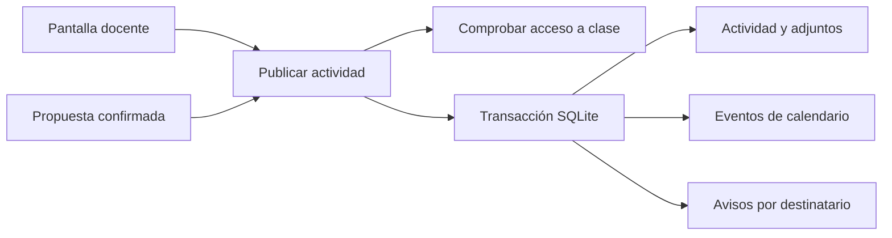

# Arquitectura propuesta para AXON 0.8

**Decisión propuesta para revisión.** Mantener FastAPI, SQLite y el cliente React. Organizar el servidor como un monolito modular permite publicar una actividad, guardar su fecha y emitir avisos en una misma transacción. El portal de Pages conserva su despliegue estático independiente. Ollama, los procesadores de archivos y el túnel conservan sus límites de proceso actuales.

## Mapa de responsabilidades y dependencias

Los nombres de la primera columna designan módulos futuros. Las fuentes de la segunda columna existen en `backend/app`, salvo indicación expresa. La última columna muestra una interfaz propuesta y los colaboradores que necesita. Las interfaces reciben la identidad y el ámbito comprobados por el servidor cuando la operación los requiere.

| Módulo | Punto de partida en 0.7 | Datos y decisiones a su cargo | Interfaz propuesta y dependencias |
| --- | --- | --- | --- |
| Autenticación y permisos · `access` | `auth`, `policy`, `guest`, `remote`, `teacher_demo`, filtros de `main` | Sesiones, intentos, CSRF, expiración, perfil de acceso, cuotas y revocación. Las políticas de clase continúan junto al recurso. | `resolve_actor(request)`, `revoke_sessions(user_id)`. Recibe un lector de cuentas y las políticas del perfil durante el arranque. |
| Usuarios y organizaciones · `accounts` | `admin`, `installation`, `models`, alta de cuentas en `auth` | Cuentas, rol, estado, preferencias, pertenencia al centro y datos básicos del centro. Único escritor de los campos de `users`, incluido el hash ya existente. | `find_account(user_id)`, `change_role(actor, user_id, role)`. El caso de uso de cambio de rol coordina la escritura con la revocación de sesiones en la misma transacción. |
| Estructura educativa · `education` | `admin`, `nebula`, `nebula_models`, `education_settings`, partes de `academic_import` | Curso académico, etapas de ESO, Bachillerato y FP, grupos, aulas, tutorías, matrículas académicas y asignaciones docentes. Generación explícita del entorno ficticio. | `get_roster(actor, group_id)`, `assign_teacher(actor, assignment)`. Consulta cuentas y centros. El generador coordina los módulos a través de sus operaciones de alta. |
| Asignaturas y clases · `classes` | `classes`, `class_policy`, `class_files`, `class_examples`, admisión en `education_settings` | Catálogo de asignaturas, clases, miembros, equipos, temas, tablón, materiales vinculados y admisión. Documento y vínculo de clase tienen propietarios distintos. | `list_classes(actor)`, `authorize_class(actor, class_id, action)`, `admit_member(actor, request_id)`. Usa estructura, cuentas y servicios autorizados de documentos y avisos. |
| Actividades y evaluaciones · `assessment` | `classwork`, `education`, ponderaciones y solucionarios en `education_settings`, `grades`, `materials` | Enunciados, publicación, entregas individuales y de equipo, revisiones, rúbricas, calificaciones y simulaciones privadas. Conserva las tareas históricas. | `publish_activity(actor, command)`, `submit_work(actor, command)`, `simulate_grade(actor, scenario)`. Usa clases, documentos, fuentes de criterios, calendario y avisos. La calificación docente y la simulación tienen comandos distintos. |
| Calendarios y horarios · `calendar` | `education`, `class_calendar`, `academic_import`, comandos de `tools` | Horarios de centro y personales, eventos de clase, fechas de exámenes y conflictos. Mantiene visibilidad, zona horaria y versión de cada edición. | `list_events(actor, period)`, `sync_activity_dates(actor, dates)`. Usa estructura y acceso a clase. Recibe los datos de la actividad en el comando para poder sincronizar sus eventos. |
| Inteligencia artificial · `assistant` | `chat`, `agent`, `ai`, `orchestrator`, `tools`, `class_assistant`, `learning_agent`, `study`, `providers`, `mathematics` | Conversaciones, ejecuciones, propuestas y confirmaciones. Incluye ayuda al estudio y herramientas autorizadas. Adaptadores para Ollama, cálculo y proveedores opcionales. | `send_message(actor, message)`, `confirm_action(actor, action_id)`. Consulta conocimiento y llama a casos de uso de los módulos propietarios. Cada operación vuelve a validar al actor al ejecutarse. |
| Memoria y conocimiento · `knowledge` | `memory`, `semantic`, `knowledge`, `institutional`, `atlas`, `relevance`, `research`, `universal` | Recuerdos privados, anotaciones, relaciones, vectores, fuentes, identidad ficticia y revisiones. Mantiene procedencia y visibilidad hasta el fragmento citado. | `retrieve(actor, query)`, `revise_memory(actor, revision)`, `get_criteria(actor, subject_id)`. Usa lectura autorizada de documentos. Editar o borrar un recuerdo invalida sus derivados. |
| Documentos · `documents` | `documents`, `academic_import`, `pdf_worker`, `pdf_render_worker`, `media`, almacenamiento actual | Bytes privados, metadatos, validación, extracción, fragmentación y eliminación. El importador entrega datos validados al módulo académico pertinente. | `store_document(actor, upload)`, `read_attachment(actor, grant)`. Un permiso interno de lectura se construye al verificar el recurso en el servidor. Se comprueban también el documento y el centro. |
| Notificaciones · `notifications` | `education.notify`, `notifications`, `scheduler`, avisos en `classwork` y `classroom` | Bandeja, preferencias, destinatarios y deduplicación. La programación aporta fechas y los módulos que producen el aviso aportan su contexto. | `notify_once(recipient, message, dedup_key)`, `list_notifications(actor)`. Consulta preferencias a través de cuentas. Un trabajo programado recibe los eventos y entregas autorizados. |
| Administración · `administration` | `admin`, `operations`, `installation`, `backup`, `cli`, `reports`, `extensions`, `fictionalize`, lanzadores de demo | Configuración inicial, controles del servidor, informes, auditoría, copias, recuperación, portabilidad, borrado personal, módulos y demostraciones. Las salidas de aula conservan registro y ámbito del grupo. | `export_user_data(actor, user_id)`, `restore_to_new_directory(operator, archive)`. Coordina responsables de datos y adaptadores de operación. Distingue al administrador de una demo del operador local. |
| Interfaz y PWA · `frontend` | `frontend/src/App.tsx`, `core.tsx`, `api.ts`, pantallas, `pages-main.tsx`, `server-portal.tsx` y `public/sw.js` | Navegación, perfil, pantallas por rol, instalación, accesibilidad, modo sin conexión y quiosco público. Preserva identidad visual y opciones existentes. | Contratos HTTP versionados por comportamiento, cookie de origen propio y cliente tipado. El portal estático comprueba `/api/public/connection` y abre el servidor elegido. |

El catálogo de asignaturas pertenece a clases. La estructura educativa puede guardar su identificador en una asignación docente. La validación que requiere ambos catálogos se compone desde el caso de uso de alta. El generador de la demo vive en la composición de instalación y usa ambas interfaces. Una relación de base de datos no obliga a que los dos módulos se importen entre sí.

## Cómo se comunican

Este recorrido ilustra qué componentes intervienen cuando un profesor publica una actividad desde la interfaz o confirma la propuesta del asistente.



1. **Entrada y autorización.** Una ruta traduce la petición a un comando o consulta tipados. La sesión determina usuario, rol, centro y perfil. El propietario del recurso comprueba pertenencia, versión y visibilidad. HTTP, automatizaciones e IA llaman al mismo caso de uso. Las funciones de dominio reciben datos tipados y el contexto requerido.
2. **Publicación de una actividad.** Evaluación consulta acceso de clase, guarda la actividad, entrega las fechas a calendario y solicita los avisos. El caso de uso abre y confirma una sola transacción. Ante un fallo se revierten todas las escrituras. Un reintento con la misma operación conserva una actividad, sus eventos previstos y un aviso por destinatario. Calendario recibe la fecha y las referencias que necesita en el comando.
3. **Entrega con archivo.** La política de la clase comprueba pertenencia, equipo y fecha de apertura. Documentos valida y prepara el archivo. Evaluación guarda el vínculo en la revisión correspondiente. Un fallo revierte el vínculo y obliga a limpiar el archivo recién preparado. La descarga vuelve a evaluar el permiso actual, incluidos los adjuntos de exámenes todavía cerrados.
4. **Recuperación y propuesta de IA.** Conocimiento selecciona fuentes visibles para el actor. El asistente recibe texto con procedencia, construye una propuesta y la presenta. La confirmación revalida actor, permisos, versión y plazo antes de llamar al responsable de la operación. Borrar o corregir una fuente debe repercutir en las búsquedas siguientes.
5. **Tareas, lecturas conjuntas e integraciones.** El planificador invoca consultas públicas y procesa reintentos con clave estable. La lista de pendientes combina las tareas históricas y las de clase. Classroom conserva el acceso de solo lectura y la importación personal. Los paneles e informes agregan consultas ya filtradas. Estas composiciones viven fuera de los módulos que consultan.

Los tipos compartidos iniciales se limitan a valores realmente comunes, como identificador del actor, centro y fecha con zona horaria. Un colaborador que necesite datos define la operación mínima que consume. El arranque conecta el proveedor concreto. Esto permite separar, por ejemplo, autenticación de cuentas y recordatorios de evaluación. Un módulo llama a la interfaz pública de su colaborador y reserva sus manejadores web y detalles SQL para uso interno.

## Estructura orientativa

```text
backend/app/
  bootstrap/           composición, perfiles, arranque y planificador
  modules/<module>/    casos de uso y política del módulo
  platform/            adaptadores SQLite, archivos, trabajadores y conexiones externas
backend/migrations/    cadena Alembic común
frontend/src/
  features/            pantallas y flujos educativos
  shared/              transporte HTTP, tipos y componentes usados por varias vistas
frontend/public/       manifiesto, service worker y recursos públicos
```

La estructura se creará al migrar el primer caso de uso que la necesite. Compartir una base y una cadena de migraciones preserva las transacciones actuales. El adaptador SQLite registra explícitamente las tablas del esquema. Los módulos de producto mantienen la propiedad de sus datos y las decisiones de acceso. La elección de proveedor externo, el tiempo máximo de espera y su modo de degradación quedan en cada adaptador.

Cada módulo incorporado tendrá un `README.md` con responsabilidad, componentes, dependencias autorizadas, interfaces, decisiones, pruebas y límites pendientes. El [plan por fases](../../../ROADMAP.md) identifica cuándo comprobar estos contratos y cómo volver al comportamiento anterior.
